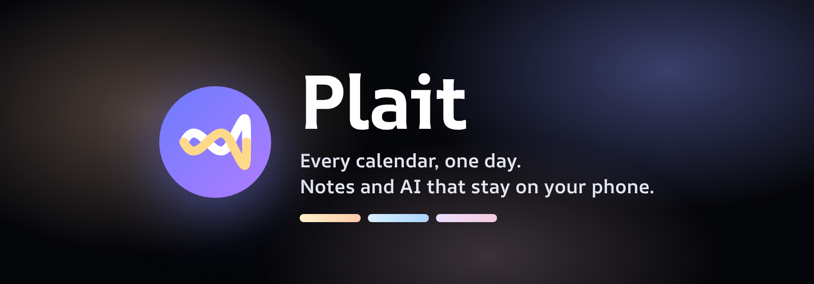
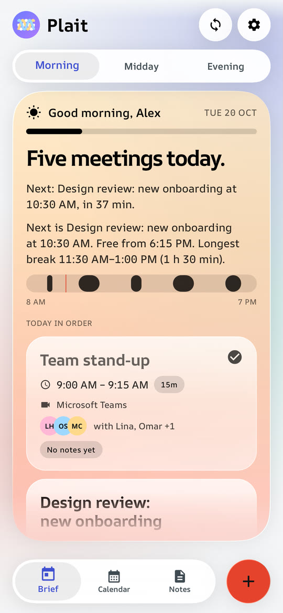
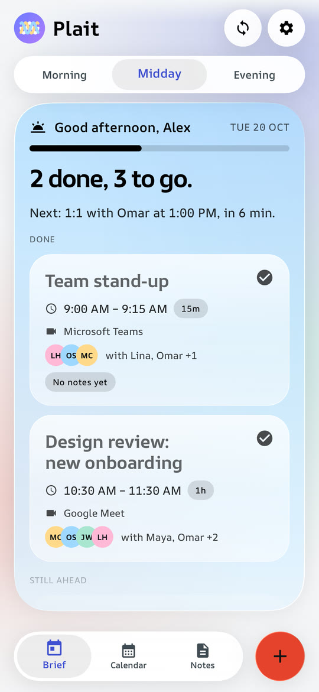
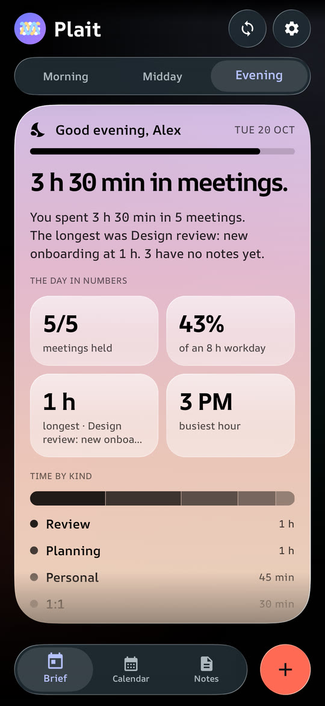
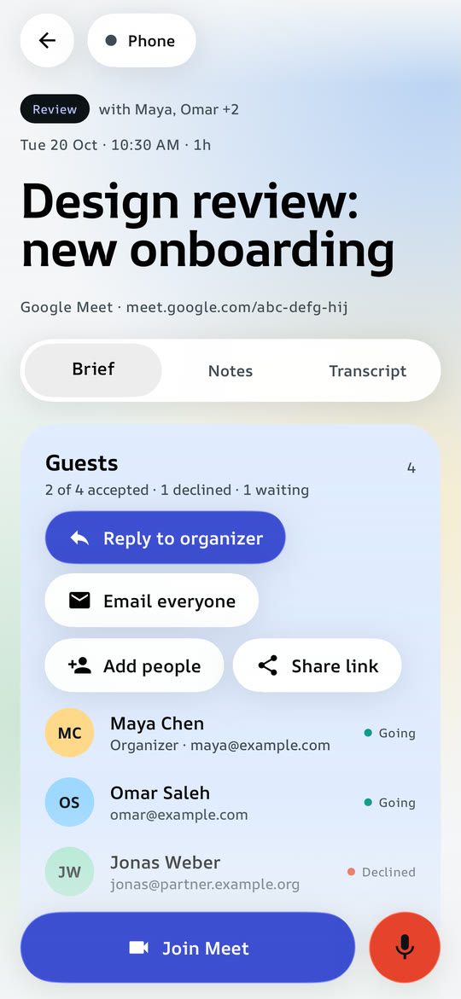
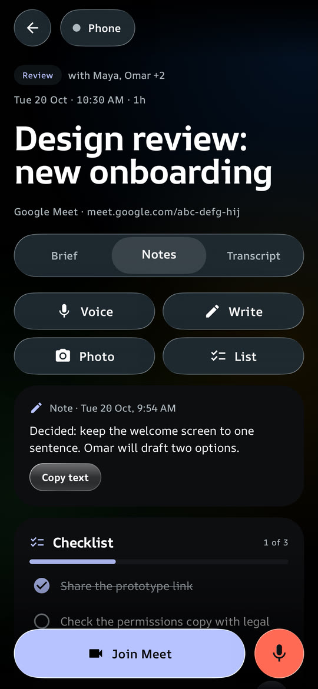
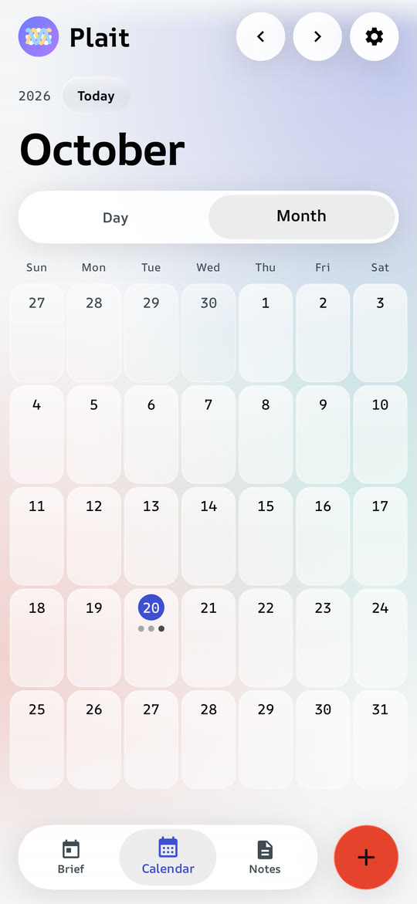
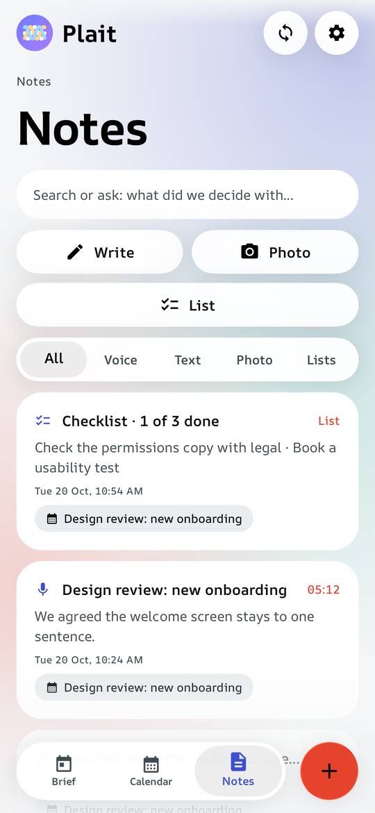
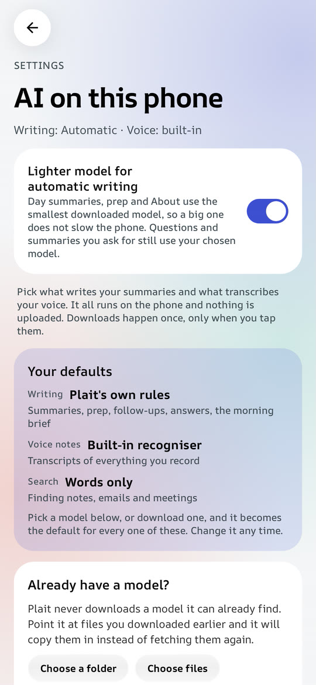

<p align="center">
  
</p>

<p align="center">
  <a href="https://x.com/3shmaaa"></a>
</p>

<p align="center">
  <b>An Android calendar that puts every account into one day.</b><br>
  Google, Outlook, Exchange, iCloud and calendar links in one agenda, a brief for every meeting, meetings you can manage,
  voice, written, photo and checklist notes, a day-brief widget, and AI that runs on the phone.
</p>

<p align="center">
  <a href="../../releases/latest/download/plait.apk">Download</a> ·
  <a href="#install">Install</a> ·
  <a href="https://mo3shma.github.io/ProjectPlait/">Website</a> ·
  <a href="https://mo3shma.github.io/ProjectPlait/trailer.html">Watch the trailer</a> ·
  <a href="#privacy-and-permissions">Privacy</a>
</p>

<p align="center">
  <a href="https://mo3shma.github.io/ProjectPlait/trailer.html">
    
  </a>
  <br>
  <sub>Click the preview to watch the full launch trailer.</sub>
</p>

---

## What you get

**Every calendar, merged.** Plait reads the calendars Android already syncs (Google, Outlook and Exchange, Samsung, and iCloud through a CalDAV app), calendar links (`.ics`) with repeating meetings expanded, and Google Calendar directly. You can switch accounts and single calendars on and off.

**A home that follows the day.** Morning, Midday and Evening cards. The morning card shows what's ahead. Midday shows what's done and what's still to come. The evening card shows your time in meetings, which meetings still need notes, and a look at tomorrow, with an offer to hold a free stretch for focus.

**Meeting pages.** Guests and their answers. **About this meeting** sums the invite up in a short paragraph. When the invite has no details, it says what the meeting is likely about from its title, in one careful line. A summary of your notes for that meeting. One-tap **Join** for Teams, Meet, Zoom and Webex, even when the link is hidden behind Outlook Safe Links.

**Manage meetings.** For meetings you organise: edit details, reschedule, cancel one occurrence, or delete the whole series. For meetings someone else organised: answer **Going**, **Maybe** or **Decline**. It works for phone calendars and for Google, and guests are notified.

**Notes four ways.** **Voice** notes are transcribed live while you record, even with the screen off. **Write** a note. A **Photo** is read into copyable text, including Arabic. A **List** is a checklist for agendas and follow-ups.

**Series remember.** Notes, photos and lists from one meeting carry forward to the next meeting with the same name. They come with the decisions from last time and the follow-ups that are still open.

**Search that understands.** Search covers meetings, transcripts, written notes, photo text and emails, in English and Arabic. With an AI chosen, Plait widens your question into related words and names, then answers from your notes and shows its sources.

**Prep and follow-ups.** Before each meeting you get a 30-second plan: the goal, what to remember and what to raise. Follow-ups are pulled from your notes. Mark them done, or book them into a free slot.

**Suggested tasks.** After a voice note or a photo of a whiteboard, Plait suggests the tasks it heard or read, with a due time when the note gives one. Add one and it joins the meeting's checklist with a reminder; the notification has Done and Tomorrow buttons.

**A day brief on your home screen.** The widget comes in four sizes: 2×1, 2×2, 4×2 and 4×4. Each shows the same day with a layout for its size, and the larger ones add a live countdown and Join.

**Alerts with Join.** A reminder before each meeting says what it's for and has a Join button. It also shows on a paired Wear OS watch. In the evening, a nudge lists the meetings that still have no notes.

**Quick add and free times.** Type "lunch with sam@acme.com friday 1pm for 1h at Cafe Nero" and the new-meeting form fills itself in. **Find a time** lists the free gaps across your calendars.

**Share, sync and back up.** Share a meeting as a PDF, Markdown or plain text, or send your notes to a teammate. Sync between your phones through a folder you already use (Drive, Dropbox, Nextcloud, Syncthing), encrypted on the phone. You can also export a backup sealed with a passphrase.

**Two looks.** *Liquid Glass* is blurred, tinted glass that's lit at the edge. *Material 3 Expressive* uses your Material You colours, shape-morphing buttons and spring motion. Both follow light and dark mode, with pure black for OLED screens and an option to reduce animations.

<table>
  <tr>
    <td width="50%"><br><sub><b>Morning</b>: the day's headline, what's next, and every meeting in order.</sub></td>
    <td width="50%"><br><sub><b>Midday</b>: what's done and what's still to come.</sub></td>
  </tr>
  <tr>
    <td width="50%"><br><sub><b>Evening</b>, in dark mode: the day in numbers.</sub></td>
    <td width="50%"><br><sub><b>A meeting</b>: guests and their answers, and one-tap Join.</sub></td>
  </tr>
  <tr>
    <td width="50%"><br><sub><b>Notes on a meeting</b>: voice, written, photo and checklists.</sub></td>
    <td width="50%"><br><sub><b>Calendar</b>: the month at a glance, or a day at a time.</sub></td>
  </tr>
  <tr>
    <td width="50%"><br><sub><b>Notes</b>: every note in one place, with search and filters.</sub></td>
    <td width="50%"><br><sub><b>AI on this phone</b>: pick what writes and what transcribes.</sub></td>
  </tr>
</table>

<sub>The meetings and people in the screenshots are examples.</sub>

## On-device AI

Choose the engine in **Settings → AI on this phone**. Models show their size before you download them, keep downloading when you leave the app, are never downloaded twice, and can be deleted to get the space back. Nothing is sent to a cloud AI.

| Engine | What it does |
| --- | --- |
| Gemini Nano (ML Kit GenAI) | Writing and answers on phones that ship it |
| Qwen3 0.6B (347 MB) / Qwen3 1.7B (977 MB) (LiteRT-LM) | Writing and answers on 64-bit phones, after a one-time download |
| Gemma 4 E2B (2.6 GB, LiteRT-LM) | The best writing, Arabic included, on phones with 8 GB of RAM |
| Qwen 2.5 0.5B / 1.5B (MediaPipe LLM Inference) | Writing and answers on any phone, 32-bit ones included |
| Whisper Tiny / Base / Small (sherpa-onnx) | Live words while you record, and the final transcript of a voice note, Arabic included |
| Text embedder (6 MB) | Search by meaning |
| Rules | Always available, no model needed |

Everything the AI writes that Plait shows as fact goes through the same harness:

1. **Clean input.** HTML, style sheets, scripts, links, dial-ins and codes are removed in code first.
2. **Rules apart from material.** The instructions go in the system message. The invite is fenced off as material, never as instructions.
3. **Low temperature (0.2),** so the model keeps to the likeliest words.
4. **A fixed JSON shape** (a short paragraph, a one-line guess, or a list of tasks). A broken answer gets one retry.
5. **Checked in code.** Word limits, no code or links, and no name or number that isn't in the source.
6. **Rules as the fallback.** If nothing passes, plain rules take over.

Writing you didn't ask for, such as the day summary, prep and About, waits for the screen to settle and runs on the smallest installed model, so a large model never slows the app.

## Install

Plait isn't on Google Play yet, so you install the APK yourself. It takes about a minute.

1. On your Android phone (Android 8 or newer), download **`plait.apk`** from the [latest release](../../releases/latest). On an older 32-bit phone, take `plait-armv7.apk` instead (if `plait.apk` says it can't be installed, that's the one).
2. Open it. If Android asks, allow your browser or file manager to install apps.
3. Open Plait, tap **Use my phone's calendars** and allow access. Every account on the phone appears straight away.
4. Optional: add calendar links or Google in Settings, and pick an AI model under **Settings → AI on this phone**.

### Adding calendars

- **Already on the phone (no setup):** everything the phone's own Calendar app syncs. That covers Google, Outlook and Exchange, Samsung, and iCloud through a CalDAV app such as DAVx5. Calendars you hide there stay hidden.
- **By link (no sign-in):** Settings → Import a calendar, then paste a published `.ics` link. Plait refreshes it every 15 minutes.
  - **Outlook / Microsoft 365:** Outlook on the web → Settings → Calendar → Shared calendars → Publish a calendar → "Can view all details" → copy the ICS link.
  - **iCloud:** Calendar app → share the calendar → Public Calendar → copy the link.
  - **Google:** Calendar settings → Integrate calendar → Secret address in iCal format.

  Anyone who has a published link can read the calendar, so keep it private like a password.
- **Google directly:** needs a one-time Google Cloud setup. Plait holds no client ID or secret, and Google recognises the app by its package name and signing certificate.
  1. In [console.cloud.google.com](https://console.cloud.google.com), create a project and enable the **Google Calendar API**.
  2. Set up the OAuth consent screen: External, add yourself as a test user, and add the `calendar.readonly` and `calendar.events` scopes.
  3. Credentials → OAuth client ID → **Android**, with package `app.plait` and the SHA-1 of the APK you installed. For the APK from the Releases page that's `77:EC:81:98:56:2D:3C:F1:81:44:EC:17:45:7B:31:B6:07:2E:52:BC`.
  4. In Plait, go to Settings → Advanced and switch on **Read Google directly**.

### Good to know

- **Updating.** Plait tells you when a new version is out and installs it for you, keeping your notes and settings. The first time, Android asks you to let Plait install apps. You can also check by hand in Settings → Updates and help.
- **Moving phones.** Settings → You and backups → Export backup, then Import backup on the new phone. Importing only adds what's missing and never deletes anything.
- **Recording.** Plait records your own microphone only, not the other side of a call. Depending on where you are, recording a conversation can need the other people's consent.

## Using it

| To do this | Do this |
| --- | --- |
| See the day | Home. Swipe or tap Morning, Midday or Evening |
| Join a call | **Join** on a meeting card or a meeting page |
| Take a voice note, record a call, or make a meeting | The **+** button at the bottom right |
| Add a written, photo or checklist note | Write, Photo or List on a meeting page or the Notes tab |
| Edit, reschedule, cancel or answer a meeting | The calendar button at the top right of the meeting page |
| Delete a note | Swipe it left (with Undo), or press and hold for more |
| Search or ask your notes | The Notes tab search box |
| Change month or day | Calendar tab, swipe sideways. Tap a day to see its events |
| Add the widget | Press and hold the home screen → Widgets → Plait |
| Switch look, theme or animations | Settings → Appearance |
| Choose or download an AI model | Settings → AI on this phone |
| Sync between your phones | Settings → Sync between your phones |

## Privacy and permissions

Plait has no account, no analytics, no ads and no server of its own. Your recordings, notes, photos and models stay in the app's storage on the phone. The network is used for only five things: calendar links, Google Calendar if you connect it, model downloads you start, the sync folder you choose, and a check of GitHub for a new version of Plait (at most twice a day, sending nothing about you; it can be switched off).

| Permission | Why it is needed |
| --- | --- |
| `READ_CALENDAR`, `WRITE_CALENDAR` | Showing your calendars, and saving new meetings, edits, reschedules, cancellations and replies |
| `RECORD_AUDIO`, `FOREGROUND_SERVICE_MICROPHONE` | Voice notes, including while the screen is off |
| `POST_NOTIFICATIONS`, `SCHEDULE_EXACT_ALARM` | Meeting alerts with Join, and the evening notes reminder |
| `RECEIVE_BOOT_COMPLETED` | Putting the alerts back after the phone restarts |
| `INTERNET` | Calendar links, Google Calendar, model downloads, sync and update checks |
| `FOREGROUND_SERVICE_DATA_SYNC`, `WAKE_LOCK` | Keeping a model or update download going when you leave the app |
| `REQUEST_INSTALL_PACKAGES` | Installing Plait's own updates, after you allow it once |
| Contacts and photos | Through Android's own pickers, so Plait sees only the contact or picture you pick |

## How it is built

Native Android in Kotlin and Jetpack Compose. The app ships as a release build with ahead-of-time profiles and is covered by 273 unit tests.

| Layer | Technology |
| --- | --- |
| Language and UI | Kotlin 2.4, Jetpack Compose, Material 3 1.5 (expressive components). Android 8.0 (API 26) to Android 16 (API 36) |
| Glass | [Kyant Backdrop](https://github.com/Kyant0/AndroidLiquidGlass): backdrop blur and lens refraction |
| Calendars | Android `CalendarContract` (read and write), Google Calendar API, an iCalendar parser with `RRULE` expansion |
| Language models | LiteRT-LM 0.18.1 (`.litertlm` models), MediaPipe `tasks-genai` 0.10.35 (`.task` models), ML Kit GenAI Prompt (Gemini Nano) |
| Speech | Whisper through sherpa-onnx for the live words (a phrase at a time) and the final transcript |
| Text in photos | ML Kit Text Recognition (Latin), Tesseract 4 (Arabic) |
| Backup and sync | AES-256-GCM with a PBKDF2-SHA256 key and sealed 1 MB chunks. A merge only adds notes and carries deletions, so a sync can't lose a note |
| Widget and alerts | RemoteViews layouts mapped to widget size, exact alarms, a microphone foreground service |

| Folder | What it holds |
| --- | --- |
| `app/src/main/java/app/plait/ui/` | Screens, Liquid Glass and Material components, theme and motion |
| `app/src/main/java/app/plait/data/` | Calendars (device, Google, `.ics`), notes, the brief, invite cleaning, search, sync |
| `app/src/main/java/app/plait/ai/` | The AI facade, local models, the harness, the model catalogue |
| `app/src/main/java/app/plait/audio/` | Recording, live and Whisper transcription, playback |
| `app/src/main/java/app/plait/widget/` | The day-brief widget |
| `docs/` | The website, the trailer and the images used here |

To build it you need JDK 17+ and the Android SDK (platform 36). Then run:

```
./gradlew :app:assembleRelease      # app/build/outputs/apk/release/app-release.apk
./gradlew :app:testDebugUnitTest
```

What changed in each version is in the [changelog](CHANGELOG.md).

### Releasing

Releases are built and published by GitHub Actions ([`release.yml`](.github/workflows/release.yml)). To release, do three things and push to `main`:
1. Raise `versionCode` and `versionName` in `app/build.gradle.kts`.
2. Add a `## <version>: <title>` section at the top of `CHANGELOG.md`. It becomes the release notes.
3. Push.

The workflow runs the tests, builds the APK, checks that it is signed with the Plait key, and publishes release `v<version>` with `plait.apk` attached. A version that is already released is skipped. It needs four repository secrets: `PLAIT_KEYSTORE_BASE64`, `PLAIT_STORE_PASSWORD`, `PLAIT_KEY_ALIAS` and `PLAIT_KEY_PASSWORD`.

## Support the creator

Plait is made by one person. If it makes your days easier, following on X is the best way to say thanks and to hear about new features first.

<p>
  <a href="https://x.com/3shmaaa"></a>
</p>

Bug reports and ideas are welcome in the [issues](../../issues).

## Third-party

[Backdrop](https://github.com/Kyant0/AndroidLiquidGlass) (Apache-2.0), [sherpa-onnx](https://github.com/k2-fsa/sherpa-onnx) (Apache-2.0), [Tesseract4Android](https://github.com/adaptech-cz/Tesseract4Android) (Apache-2.0), [GSAP](https://gsap.com) (standard no-charge licence), and the AR One Sans font (SIL Open Font Licence 1.1). The sites and services named here belong to their owners.
